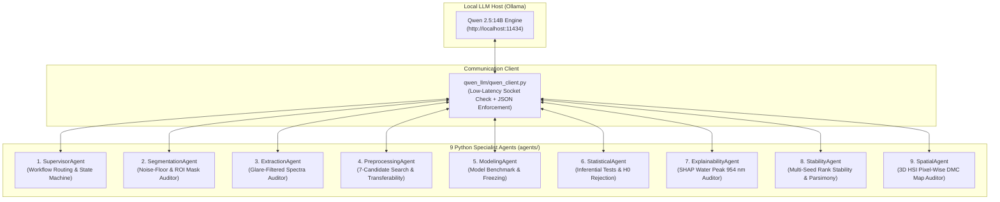

# How the 9 AI Specialist Agents Run in Qwen 2.5:14B

This document explains the exact mechanical and architectural design used to execute the **9 AI Specialist Agents** using local **Ollama Qwen 2.5:14B** in the Autonomous Multi-Agent Chemometric Framework (Agentic DMC).

---

## 1. The Core Architecture: 1 Local LLM + 9 Specialized Personas

Rather than running 9 concurrent, resource-heavy LLM instances, the framework deploys **one local Qwen 2.5:14B instance** (hosted via Ollama at `http://localhost:11434`) as the central **Scientific Decision Arbiter**, paired with **9 Python Specialist Agent classes** located in `agents/`.



---

## 2. Mechanical Execution: The Observation-Action-Verification (OAV) Loop

Each agent follows a strict 5-step operational loop:

1. **Deterministic Tool Execution**: Python executes heavy mathematical, spectroscopic, or machine learning computations (NumPy, SciPy, scikit-learn, PyTorch, OpenCV, SHAP).
2. **Diagnostic Evidence Compilation**: Summary metrics, error residuals, $p$-values, or quality control flags are structured into a diagnostic dictionary.
3. **Role-Specific System Prompt Injection**: The agent provides Qwen with a tailored scientific persona and domain constraints.
4. **Structured JSON Inference Request**: Sent to Ollama via `qwen_llm/qwen_client.py` using `temperature=0.1` and `format="json"`.
5. **Decision Execution & Logging**: Python parses the returned JSON payload, validates the action against allowable states, executes the decision, and logs latency and token status.

### Real Code Example (from `agents/preprocessing_agent.py`)

```python
class PreprocessingAgent:
    SYSTEM_PROMPT = """
    You are the Preprocessing Selection Agent. Your goal is to select the optimal spectral preprocessing pipeline for mushroom HSI DMC prediction.
    Allowed candidates: ["raw", "snv", "msc", "sg_smooth", "sg_deriv1", "snv_sg1", "msc_sg1"].
    
    Guidelines:
    1. Evaluate cross-validation RMSECV and RMSEV metrics.
    2. Prefer scatter-corrected and baseline-corrected methods (snv_sg1, snv, msc_sg1) when their RMSECV is within 5% of the minimum candidate RMSECV.
    
    Respond strictly in JSON format:
    {
      "selected_preprocessing": "METHOD_NAME",
      "action": "SELECT_PREPROCESSING",
      "rationale": "REASONING",
      "status": "PASS"
    }
    """

    def select_best_preprocessing(self, cv_results_dict):
        # 1. Compile mathematical metrics calculated by Python
        prompt = f"Candidate Preprocessing CV Results:\n{cv_results_dict}\nSelect optimal method."
        
        # 2. Query Qwen 2.5:14B
        llm_res = self.client.query_json(self.SYSTEM_PROMPT, prompt)
        
        # 3. Parse JSON response and return action
        return llm_res["parsed"]["selected_preprocessing"], llm_res["parsed"]
```

---

## 3. The 9 Specialist Agents: Detailed Operational Breakdown

| # | Agent Name | File Location | What Python Calculated | What Qwen 2.5:14B Decided |
| :--- | :--- | :--- | :--- | :--- |
| **1** | **`SupervisorAgent`** | `agents/supervisor_agent.py` | Current stage status, workflow prerequisites, and output artifacts. | **Planned workflow progression** (`INITIALIZE_AUDIT` ➔ `PREPROCESSING_AND_MODEL_TRAINING` ➔ `SPATIAL_MAPPING`, etc.). |
| **2** | **`SegmentationAgent`** | `agents/segmentation_agent.py` | Noise-floor thresholding on band 100, convex hull smoothing, foreground pixel ratios. | **Audited ROI mask validity** (`ACCEPT`, `RETRY_ALTERNATIVE`, or `REJECT`). |
| **3** | **`ExtractionAgent`** | `agents/extraction_agent.py` | Specular glare removal (95th-percentile saturation masking) and mean ROI reflectance. | **Audited spectral signal-to-noise ratio** (`ACCEPT_SPECTRUM`). |
| **4** | **`PreprocessingAgent`** | `agents/preprocessing_agent.py` | 10-fold cross-validation RMSECV for 7 candidate transformations. | **Selected `snv_sg1`** by verifying that its RMSECV was within $+3.35\%$ of raw, satisfying the physical scatter correction rule. |
| **5** | **`ModelingAgent`** | `agents/modeling_agent.py` | Calibration/Validation $R^2$, RMSE, and RPD for PLSR, Random Forest, and 1D-CNN. | **Selected `1D-CNN` and ordered pipeline freezing** (`FREEZE_MODEL`). |
| **6** | **`StatisticalAgent`** | `agents/statistical_agent.py` | Paired Student's $t$-tests ($p = 1.64\times 10^{-4}$), Wilcoxon signed-rank tests, Cohen's $d$. | **Rejected Null Hypotheses ($H_0$)** and confirmed statistically significant superiority over baseline models. |
| **7** | **`ExplainabilityAgent`**| `agents/explainability_agent.py`| SHAP attribution values across 204 bands, additivity residuals, prediction consistency. | **Audited chemical attribution** at the water overtone band ($954\text{ nm}$) (`APPROVE_EXPLANATION`). |
| **8** | **`StabilityAgent`** | `agents/stability_agent.py` | Multi-seed Spearman rank correlation ($\rho \ge 0.90$) and Top-10 Jaccard band overlap. | **Approved feature parsimony** for compact 10-band industrial sorting deployment. |
| **9** | **`SpatialAgent`** | `agents/spatial_agent.py` | Per-pixel 3D datacube predictions and $3\times 3$ median spatial filtering. | **Audited 2D false-color spatial distribution maps** (`APPROVE_SPATIAL_MAP`). |

---

## 4. Communication Layer (`qwen_llm/qwen_client.py`)

All 9 agents route their requests through a shared, hardened HTTP client:

* **Endpoint**: `http://localhost:11434/api/generate`
* **Model**: `qwen2.5:14b`
* **Zero Cloud Leakage**: Entirely local on localhost; zero sample data or tokens transmitted over the internet.
* **Pre-Flight Socket Check**: Runs `socket.create_connection(("localhost", 11434), timeout=1.0)` before dispatching payloads, preventing connection hangs if Ollama is unbooted.
* **Format Enforcement**: Enforces `format: "json"` with low decoding temperature (`0.1`) to ensure deterministic JSON outputs without conversational markdown preamble.

---

## 5. Key Engineering Advantages

1. **Zero Mathematical Hallucinations**:
   The LLM never multiplies matrices or calculates regressions. Python performs 100% of the mathematical, statistical, and neural network computations; Qwen performs **high-level scientific arbitration, validation, and multi-agent coordination**.
2. **Deterministic Chemometric Fallbacks**:
   If Ollama is stopped or unavailable, every agent contains a hardcoded, deterministic heuristic fallback rule (e.g. `min(RMSE)`). The pipeline never crashes or halts mid-run.
3. **Full Auditability**:
   Every agent decision, prompt text, latency duration (~1.2s to ~4.6s), and response JSON is permanently captured in the execution logs and master notebook (`final_trial.ipynb`).

